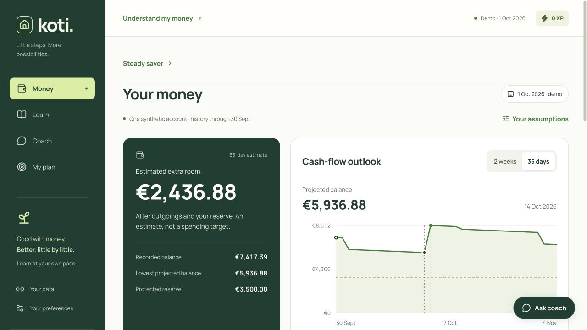
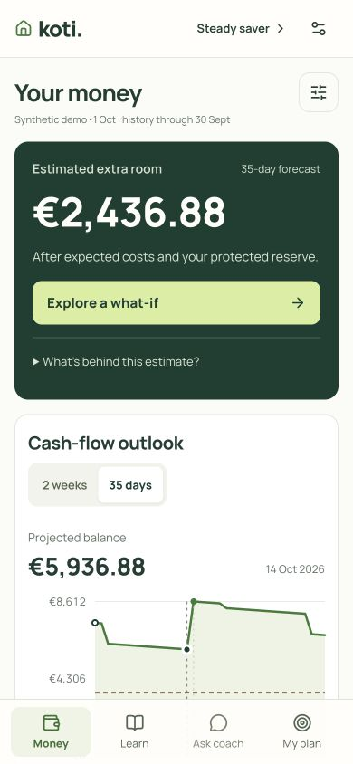
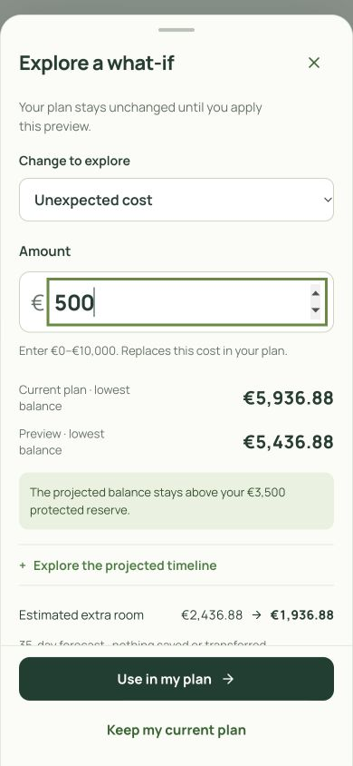
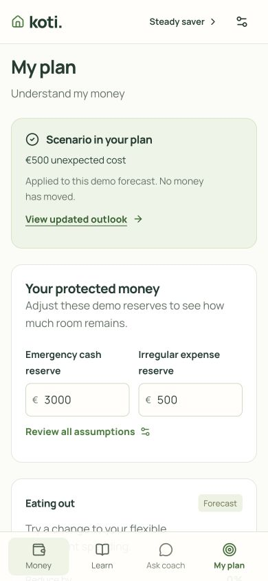

# Mobile Money → scenario → Plan review

This integration consumes the shared components from PR #37. The work is isolated on `codex/mobile-journey`; calculation, coach, API and persona logic remain with their owners.

## Before and after

| Before | After |
| --- | --- |
| Repeated mobile headers, date and persona context pushed useful content down. | A compact header keeps persona switching and data access; one synthetic-data/history label introduces Money. |
| The main amount competed with its supporting explanation and details. | Estimated extra room, meaning and Explore a what-if fit in the initial 390 × 844 viewport. The chart follows immediately. Recorded balance, lowest forecast and protected reserve expand separately. |
| A large scenario panel presented several choices together. | One adjustment at a time in a mobile sheet or centred desktop dialog; the existing engine supplies the preview. Apply explicitly carries the change into Plan. |
| Production next/link dynamically imported missing navigation exports and clicks failed. | WorkspaceLink retains native href, modified-click and keyboard semantics, using the existing working useRouter.push path for ordinary local navigation. No framework or dependency changes. |

| Money before · 390 px | Money after · 390 px |
| --- | --- |
|  |  |

| Scenario preview | Applied plan |
| --- | --- |
|  |  |

[Actual interaction recording, 9.5 seconds](money-scenario-plan.mp4): Money → unexpected cost €500 → engine preview → explicit Apply → Plan receipt. Captured from the running production browser with original frame timings; no mockup frames. All shown data are synthetic.

[Desktop Money](after-money-desktop.jpg) · [Desktop dialog](after-scenario-desktop.jpg) · [Earlier scenario](before-scenario-390.jpg) · [200% Money](after-money-200percent.jpg) · [200% chart](after-chart-200percent.jpg) · [200% sheet](after-scenario-200percent.jpg)

## Requirement evidence

| Requirement | Observed evidence |
| --- | --- |
| Compact mobile hierarchy | 390 × 844 screenshot: primary amount, meaning, action, collapsed calculation details and start of the chart are visible. Forest/lime/warm-white retained. |
| Four existing destinations, persona access | Money, Learn, Coach and Plan URLs retained. Mobile persona button opens the existing goal/persona flow. Keyboard Enter on Learn, full-conversation link, Money return link, refresh and browser Back verified on the built app. |
| Navigation-only translucency and safe areas | Local shell CSS limits blur to top/bottom navigation, has opaque fallback and reduced-transparency override, uses top/side/bottom safe-area insets and bottom content clearance. Data control is at least 44 px. |
| Amount meanings and provenance | Main amount says Estimated extra room and 35-day forecast. Chart says Projected balance. Breakdown explicitly distinguishes recorded balance, projected minimum and reserve. Synthetic source/history and coverage detail remain. Optional #32 dataset/customerLabel render directly from the coach response; evidence actions are unchanged. |
| One adjustment at a time | Native selector chooses unexpected cost, later payday or restaurant reduction. One matching input is shown; all requests use the existing /api/finance contract and integer-cent conversions. |
| Preview versus Apply | A €500 preview changes minimum €5,936.88 → €5,436.88 and extra room €2,436.88 → €1,936.88. Recorded balance stays €7,417.39. Cancel leaves the plan unchanged. Apply navigates to Plan with an explicit €500 simulation receipt. Refresh and Back retain it. |
| Persona and journey preservation | Steady saver → Generous everyday spender retains Understand my money. The latter has €1,510.36 room; a 20% eating-out preview yields €1,556.96. Cancel leaves reduction at zero. Persona/goal survive refresh. Completed the balance discovery (40 XP), applied a new €600 scenario, refreshed and returned to Learn: 40 XP saved remained. Existing learning storage and completion code are unchanged. |
| Loading, validation and retry | Pending preview disables Apply. Invalid −1 shows range feedback and disables Apply. A real stopped-server request shows a connection failure; restarting and Try again recovers the €750 preview (€5,186.88 minimum) without silently saving it. |
| Focus and dismissal | Title receives initial focus; no automatic phone keyboard. Tab is trapped, Escape/cancel returns focus to Explore, and drag dismissal works through the handle. Applying focuses the destination main region through the existing route effect. |
| Motion and transparency preferences | Actual macOS Reduce Motion and Reduce Transparency were enabled for verification and restored afterward. Browser media queries matched; sheet/overlay animation was none, transition 0s, drag handle absent, navigation opaque with no blur. Default press is 120 ms, sheet 240 ms; no amount animation. |
| Enlarged text | Temporary local 200% root-font fixture, removed after verification: Money scrollWidth=390 at viewport=390; sheet scrollWidth=clientWidth=388. Header/actions wrap, body scrolls, keyboard chart selection works. Screenshots attached. |
| Desktop | 1440 × 1000 Money and centred dialog inspected, including bounded overlay/dialog, explicit action footer and normal chart interaction. |
| Production navigation regression | Error reproduced on unchanged #37 baseline under npm start. Local workaround verified on the production build across all four destinations, dialog-to-full-conversation continuity, refresh and Back. Fresh browser error log empty after the fix. |

## Verification and limits

After merging main through #35 (c88c1a3): 126 unit tests passed; two optional raw-source/live-Supabase checks skipped. Typecheck and production build passed. API smoke passed on the built local server, including all eight personas, scenario/context isolation, scoped evidence and invalid input. The merged coach rendered #32 source labels and retained the answer when opening the full conversation. Stale-data mode paused the primary amount and chart, showed the source warning and removed the what-if action; restoring it recovered the forecast. Final browser console errors: none. Screenshots and recording precede #35’s navigation-label change from Ask coach to Ask Pesä; the Money/scenario presentation is unchanged.

The browser checks used the macOS in-app browser at explicit mobile and desktop viewport sizes. Physical iOS/Android devices, their software keyboards and mobile screen readers were not available. Safe-area support is implemented in CSS; a notched physical device still needs a hardware check. No hosted deployment, banking operation, backend calculation or dependency update is included.

Temporary test servers are stopped after canonical integration. The integration owner controls promotion to port 5174. Claude's later coach/Learn/Accounts work must preserve WorkspaceLink imports and #32 source labels when replacing existing rendering.
